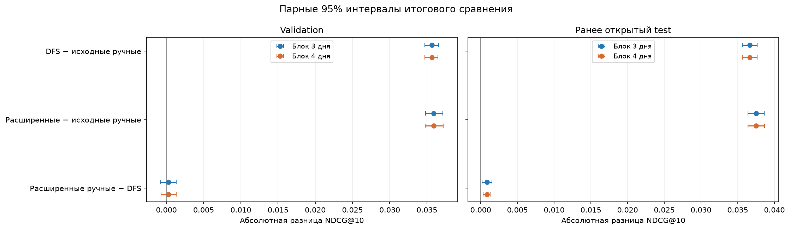

# Автоматическая генерация признаков для рекомендаций

В этой работе проверяю, можно ли автоматически получить признаки для рекомендательной системы с качеством, близким к ручному набору. Для этого использую Yambda flat 50m, Deep Feature Synthesis и CatBoostRanker.

Сначала я собрал ручные признаки и обучил бейзлайны. Затем попробовал DFS, добавил временные окна и свежесть. При проверке времени нашлась утечка через восстановленное начало прослушивания, поэтому момент запроса пришлось изменить и сравнение провести заново. Ниже приведены результаты после этого исправления.

Начать можно с [итогового ноутбука](task_1/notebooks/final-comparison.ipynb). Все пять ноутбуков читают сохранённые результаты и выполняются сверху вниз без исходного датасета и моделей. Для полного пересчёта есть отдельная команда, описанная ниже.

## Что получилось

Сравним три набора признаков. Модели обучались на одинаковых **2 021 867 строках из 40 000 целых user-day групп**. При расчёте признаков использовалась вся доступная история, а не только выбранные строки обучения.

Validation содержит **2 879 535 строк и 57 097 групп**, test — **3 160 068 строк и 61 964 группы**.

| Набор признаков | Признаков | Validation NDCG@10 | Test NDCG@10 | Test QueryAUC | Обучение, мин |
| --- | ---: | ---: | ---: | ---: | ---: |
| Исходные ручные | 42 | 0.768964 | 0.771547 | 0.604659 | 13.43 |
| Расширенные ручные | 49 | 0.804896 | 0.809040 | 0.678198 | 12.03 |
| Автоматические DFS | 462 | 0.804623 | 0.808187 | 0.676752 | 26.73 |

По таблице видно, что DFS улучшил NDCG@10 относительно исходного ручного набора примерно на 4.6% на validation и 4.7% на test. Но после добавления семи признаков общей истории пользователя ручной набор получил сопоставимое качество на validation и немного большее на test. Разница на test составила `0.000853` NDCG. Её практическую значимость для продукта здесь не проверяю.

При этом расширенный ручной вариант обучался около 12 минут, а DFS — около 27. **Превосходство DFS над расширенным ручным набором не подтвердилось.** Получить полезные признаки автоматически удалось, но сильный ручной набор оказался дешевле по времени обучения.

Test повторно использован после исправления времени; модели оценены без переобучения и подбора.

### Насколько устойчивы различия

Для трёх заранее выбранных пар посчитаны абсолютные разницы NDCG@10. Интервалы получены парным циклическим блочным bootstrap по дням: блоки 3 и 4 дня, 20 000 реплик, seed 42, двусторонние 95% percentile-интервалы. Вес user-day групп сохраняется.

| Пара | Validation Δ | 95% CI, блок 3 дня | 95% CI, блок 4 дня |
| --- | ---: | --- | --- |
| DFS − исходные ручные | +0.035660 | [+0.034721; +0.036555] | [+0.034737; +0.036497] |
| Расширенные − исходные ручные | +0.035932 | [+0.034839; +0.037168] | [+0.034757; +0.037190] |
| Расширенные ручные − DFS | +0.000272 | [−0.000782; +0.001345] | [−0.000710; +0.001317] |

| Пара | Повторный test Δ | 95% CI, блок 3 дня | 95% CI, блок 4 дня |
| --- | ---: | --- | --- |
| DFS − исходные ручные | +0.036640 | [+0.035678; +0.037642] | [+0.035622; +0.037652] |
| Расширенные − исходные ручные | +0.037493 | [+0.036403; +0.038619] | [+0.036425; +0.038668] |
| Расширенные ручные − DFS | +0.000853 | [+0.000173; +0.001539] | [+0.000315; +0.001302] |

На validation интервалы разницы расширенного ручного набора и DFS включают ноль; на повторном test оба положительны в пользу ручного набора.



Интервалы условны на готовых моделях и выбранных признаках, без поправки на множественные сравнения.

Готовые таблицы: [validation](docs/results/c4/validation_comparison.csv), [интервалы validation](docs/results/c4/validation_intervals.csv), [test](docs/results/c4/test_comparison.csv), [интервалы test](docs/results/c4/test_intervals.csv).

## Данные и метки

Я выбрал [Yambda](https://huggingface.co/datasets/yandex/yambda) в варианте [flat 50m](https://huggingface.co/datasets/yandex/yambda/tree/dd6f3a19eef5866e346c3270e098baa641a44948/flat/50m), потому что в нём есть повторные прослушивания и явные реакции. В используемом файле 10 000 пользователей, 934 057 треков, 46 467 212 прослушиваний и 1 323 237 реакций.

Готовой трёхуровневой релевантности здесь нет, поэтому использую следующую разметку. Правила применяются сверху вниз:

| label | Правило |
| --- | --- |
| 2 | К прослушиванию привязан like |
| 0 | Иначе: есть dislike или прослушано менее 35% трека |
| 1 | Остальные прослушивания |

Реакция привязывается к ближайшему следующему окончанию прослушивания той же пары user-item, если она попала в восстановленный интервал. При обеих реакциях приоритет у like. Unlike и undislike напрямую метку не задают. Это эвристика, а не истинная релевантность из датасета.

В анализе доли прослушивания видны два пика: около начала и полного трека. Порог 35% выбран как эвристика. Сохранённые графики и другие наблюдения есть в [анализе данных](task_1/notebooks/dataset-analysis.ipynb).

## Почему пришлось изменить время запроса

Сначала начало прослушивания восстанавливалось по формуле `S = floor(E - L * R / 100 - 5)`, где `E` — исходный timestamp, `L` — длина трека, `R` — текущая доля прослушивания. Признаки считались по истории до `S`.

Проблема в том, что сама граница истории зависела от исхода события, который нужно предсказать. В данных `E` и `L` лежат на пятисекундной сетке, поэтому секундный остаток свежести мог передавать информацию о текущем `R`.

На прежней validation таблица частот, построенная на train только по этой фазе, давала **ROC AUC 0.7542** для метки 0 против остальных. Это диагностический ROC AUC, не QueryAUC ранкера. При перемешивании пользовательской свежести внутри одинаковых `(L, floor(F/5))` NDCG замороженных моделей C2b и D462-sub снизился на **0.0430 и 0.0446**. Здесь `F` — время с последнего доступного события пользователя.

После этой диагностики время запроса, признаки, split и группы пересчитаны заново. Падение при перестановке описывает чувствительность готовых моделей; причинная доля утечки им не измеряется. Подробности — в [проверке времени](docs/start-time-audit.md).

## Как устроено основное сравнение

Для каждого пользователя прослушивания с одинаковым исходным timestamp объединяются в пакет. Для следующего пакета момент запроса `t` равен предыдущему **строго меньшему** timestamp этого пользователя. Первый пакет исключается.

```text
предыдущий timestamp = t
цель = следующий наблюдавшийся временной пакет
история = исходные события с timestamp < t
```

Пакет прямо на границе `t` тоже не входит в историю. Окна имеют вид `[t-window, t)`. Для одинаковых исторических timestamp используется исходный ID строки, без сортировки по label или доле прослушивания. Порядок внутри временного бина неизвестен.

Строка исключается, если любой привязанный к целевому прослушиванию like/dislike уже произошёл раньше `t`. В train таких исключений 448, в validation 170, в test 191. Это правило зависит от исхода и меняет состав выборки.

| Часть | Момент запроса, дни с нуля | Дополнительное условие |
| --- | --- | --- |
| Train | `[225, 270)` | Конец целевого прослушивания раньше `270*DAY - 1800` |
| Validation | `[270, 285)` | Конец целевого прослушивания раньше `285*DAY - 1800` |
| Test | От 285 до конца журнала | Следующий пакет наблюдался; конечного GAP нет |

История начинается с начала журнала и обновляется в validation/test по мере доступности событий. Веса моделей при этом не меняются. Старый `start_ts` остаётся в правиле привязки реакций, но не задаёт момент расчёта признаков.

Основная метрика — NDCG@10 с линейной релевантностью 0/1/2, дополнительная — QueryAUC Ranking. Группа `uid*1000 + floor(t/DAY)` соответствует пользователю и дню. Группы с постоянной меткой удаляются во всех частях.

Такое ранжирование объединяет наблюдавшиеся события с разными моментами запроса в пределах user-day. Точные ничьи во внешнем NDCG разрешаются общей перестановкой с seed 42; встроенная метрика CatBoost при early stopping делает это иначе.

## Какие признаки сравниваю

**Исходные ручные: 42 входа.** Это `is_organic`, длина трека и 40 исторических признаков:

| История | Признаки |
| --- | --- |
| Трек | Число прослушиваний, доля пропусков, отношение лайков к прослушиваниям, средняя доля прослушивания; окна 1/7/30/90 дней |
| User-item | Прослушивания и пропуски за 7/14/30/90 дней, затухающие счётчики, давность последнего прослушивания, состояние like/unlike |
| User-artist | Прослушивания, пропуски и затухающие счётчики по исполнителю |

Затухающие счётчики суммируют веса `2 ** (-age / half_life)` с периодами полураспада 1/7/30 дней.

**Расширенные ручные: 49 входов.** К исходному набору добавлены доля прослушивания и skip последнего доступного трека, skip-rate последних 5/20 событий, skip-rate и число событий за сутки, время с последнего события пользователя. Прямые user-item и косвенные user-artist связи были уже в исходных 42 признаках.

**Автоматические DFS: 462 входа.** [Deep Feature Synthesis (Kanter и Veeramachaneni, 2015)](https://www.maxkanter.com/papers/DSAA_DSM_2015.pdf) составляет формулы по сущностям Users, Items, UserItem и UserArtist. Я задал допустимые операции и окна 1–30 дней; отдельные формулы затем строились автоматически. Всего получилось 12 782 кандидата.

Первый top-k поиск выбрал полный набор кандидатов. Позже отдельно проверены 462 входа, которые использовались в разбиениях широкой модели. В основное сравнение этот список перенесён без нового отбора.

Все 462 выбранных входа — исторические формулы. Текущие `is_organic` и длина трека отдельно в них не вошли; в ручных наборах эти два поля используются. Источники и временные правила общие, а модельные входы различаются.

[Featuretools](https://docs.featuretools.com/en/stable/generated/featuretools.dfs.html) строит описания формул. Их значения считает отдельный накопительный движок, который переиспользует историю между запросами. Он поддерживает выбранные операции, а не все возможности Featuretools.

### Что вошло в автоматический набор

| История | Формул | Сумма нормированных важностей |
| --- | ---: | ---: |
| Пользователь | 132 | 50.21 |
| Трек | 148 | 15.69 |
| Пользователь–трек | 59 | 21.78 |
| Пользователь–исполнитель | 123 | 12.32 |

Из 462 формул 51 использует всю доступную историю, 411 — ограниченное окно. В набор вошли все длины от 1 до 30 дней. Самая высокая отдельная важность у времени с последнего события пользователя: 14.21.

Важности рассчитаны по [PredictionValuesChange](https://catboost.ai/docs/en/concepts/fstr) и описывают изменения предсказаний готовой модели. Примеры формул и полные таблицы есть в [разборе признаков](docs/feature-analysis.md).

## Обучение и затраты

Все три модели — CatBoostRanker с YetiRank: depth 6, learning rate 0.1, seed 42, до 1600 деревьев, early stopping 80, четыре потока. Параметры перенесены из прежних контролей; нового Optuna-поиска после исправления времени не было. Пороги квантования обучены только на общей новой train-подвыборке.

Подготовка и обучение сравнения заняли **67.04 минуты** после сохранения истории: признаки и проверки — 9.26 минуты, квантование — 3.72, сумма чистых fit — 52.19. Измеренный пик anonymous RAM процесса и потомков — **5.74 GiB**. Это не вся память WSL. Повторная оценка test заняла **7.47 минуты**, из них признаки — 5.18.

Матрицы записываются порциями на диск. CatBoost квантует по одному столбцу, затем части объединяются в Pool. Это ограничивает расход памяти при квантовании широкой матрицы.

На маленьких данных проверяются границы времени, совпадающие timestamp, реакции и квантование. На фактических запросах независимый pandas-пересчёт сверил 40 строк каждого split и все выбранные формулы. После загрузки моделей validation-прогнозы совпали с исходными; перед и после test проверены хеши моделей и порогов.

## Ограничения

- Новый cutoff не зависит от текущей доли прослушивания. Смысл исходного timestamp и доступность длины трека и `is_organic` остаются допущениями; физическое начало прослушивания не наблюдается.
- Разметка и привязка реакций сохраняют восстановленный `start_ts`. Исключение ранних реакций меняет состав выборки.
- Список 462 входов выбран при прежнем cutoff. Для нового протокола он может быть неоптимален; направление влияния заранее неизвестно.
- User-day — вспомогательное ранжирование наблюдавшихся событий, а не оценка полного каталога или продуктового эффекта.
- Validation использовалась повторно, test уже открывался. Интервалы не учитывают новый отбор, обучение на других seed или все возможные временные окна.
- Проверены конкретные конфигурации в ограниченном бюджете. Общего превосходства автоматических признаков над сильным ручным набором работа не показывает.

## Источники

- [Kanter, Veeramachaneni — Deep Feature Synthesis, 2015](https://www.maxkanter.com/papers/DSAA_DSM_2015.pdf): синтез признаков по связанным таблицам.
- [Yambda: статья, 2025](https://arxiv.org/abs/2505.22238v2) и [карточка датасета](https://huggingface.co/datasets/yandex/yambda): состав данных и их подготовка.
- [Featuretools 1.31: DFS](https://docs.featuretools.com/en/stable/getting_started/afe.html): библиотечное построение формул.
- [CatBoost: ранжирование и метрики](https://catboost.ai/docs/en/concepts/loss-functions-ranking): YetiRank, NDCG и QueryAUC.
- [Optuna: TPE](https://optuna.readthedocs.io/en/stable/reference/samplers/generated/optuna.samplers.TPESampler.html): подбор гиперпараметров.

Окна 1–30 дней, накопительный расчёт и новый момент запроса — адаптация для этой работы.

## Как запустить

Нужны Linux/WSL и Python 3.12:

```bash
python3.12 -m venv task_1/.venv-featuretools
source task_1/.venv-featuretools/bin/activate
python -m pip install -r task_1/requirements.txt
python task_1/src/check_project.py --smoke --skip-artifacts
```

Посмотреть сохранённые результаты:

```bash
python task_1/src/run_report_notebooks.py
```

Пересчитать все пять ноутбуков из исходных данных в отдельной чистой копии:

```bash
python task_1/src/run_experiment_notebooks.py \
  --mode recompute --run-name repeat_01 --download --include-test
```

В самих ноутбуках режим выбирается в первой кодовой ячейке: report или recompute.
Новые данные, модели и таблицы передаются между этапами с одним именем запуска.
Команда выше включает исторические обучения, Optuna и повторную test-оценку;
она требует многих часов. Только основное сравнение трёх моделей:

```bash
python task_1/src/reproduce.py --run-name repeat_main --stage all --download
```

Источники данных закреплены в [dataset_source.json](task_1/dataset_source.json).
[Инструкция](docs/reproduction.md) описывает локальные входы, отдельные этапы
и ресурсы. Проверены подготовка полной истории и малый сквозной расчёт.
Полный повтор всех обучений в чистой копии пока не выполнен.
[Фактические проверки](docs/provenance/audit_reproduction_20261025.json).

## Что лежит в проекте

- [Итоговое сравнение](task_1/notebooks/final-comparison.ipynb) — основной результат.
- [Анализ данных](task_1/notebooks/dataset-analysis.ipynb) — сохранённые графики и сводки.
- [Бейзлайны](task_1/notebooks/model-baseline.ipynb), [эксперимент 1](task_1/notebooks/experiment-1.ipynb), [эксперимент 2](task_1/notebooks/experiment-2.ipynb) — ход исследования.
- [Временной протокол](docs/c4.md), [повторная test-оценка](docs/c4-test.md), [разбор формул](docs/feature-analysis.md) — подробности основного сравнения.
- [Архив ноутбуков](docs/provenance/notebooks_before_report_mode_20261025.zip) — вычислительный код и выводы прежних ноутбуков.

В ранних опытах использовался проблемный восстановленный cutoff. К ним относятся DFS130, пять дополнительных окон, Optuna, контроли и первая test-оценка. Они показывают ход исследования. После смены времени изменились строки и история, поэтому старые и новые метрики не образуют парного сравнения. Подробности: [Optuna](docs/optuna.md), [контроли](docs/temporal-controls.md), [первый test](docs/final-test.md).

В файлах результатов остаются исходные ID: `C4` — основной временной протокол, `M-t` — исходные ручные, `C2b-t` — расширенные ручные, `D462-t` — автоматические DFS. Исторический `current_models.json` описывает первоначальные четыре модели, а не итоговое сравнение.

В подготовленный набор входят код, отчёты, формулы, небольшие таблицы и [эталон 5000 строк производных признаков Yambda](task_1/tests/fixtures/README.md). Это реальные данные старого генератора, не синтетика; рядом сохранены [Apache 2.0](task_1/tests/fixtures/LICENSE) и [описание происхождения](task_1/tests/fixtures/NOTICE). Полный датасет, модели, большие матрицы, среды и личные рабочие файлы не включаются.
